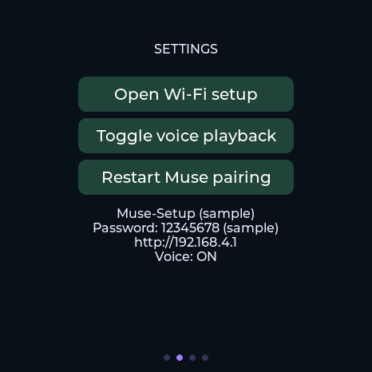
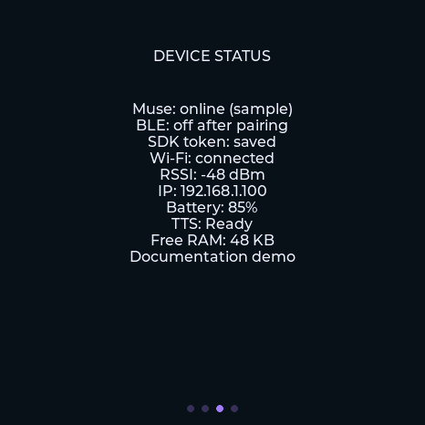
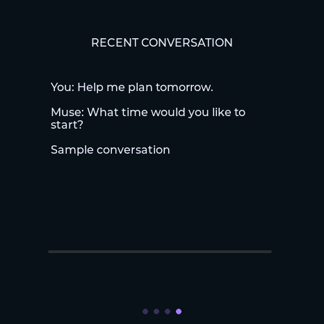

<p align="right"><strong>简体中文</strong> · <a href="README.md">English</a></p>

# Muse StopWatch

[](https://github.com/acrostm/muse-stopwatch/actions/workflows/ci.yml)

面向 **M5Stack StopWatch（ESP32-S3、16 MB Flash、8 MB PSRAM）** 的 [Muse Gadget SDK](https://github.com/facebookincubator/muse-gadget-sdk) 社区适配。提供浏览器配网、豆包语音合成 2.0、音色名称选择与试听、四个设备页面和可取消的按住说话。

仓库只包含适配代码、固定上游版本的补丁和构建工具，不包含其他 AI Passport 项目、私人配置、构建产物或上游头像素材。项目独立于 Meta 与 M5Stack。

## 功能与按键

- 右侧蓝键：按住**超过 2 秒**，松手发送；恰好 2 秒及以下直接丢弃。
- 按住蓝键时按左侧黄键：取消当前录音；先松开蓝键，再重新按住录音。取消仅适用于录音阶段，不能撤回已经提交的消息。
- 其他时候按黄键：依次切换头像、设置、状态、最近对话。内存中最多保留八条对话。
- 音频完整保留在 PSRAM 中，通过松手和时长检查后才允许上传。内存不足、采集错误、取消、达到约 15 秒录音上限而未松手时均丢弃，不会退回实时上传。
- 已确认的录音在离线时可以暂存在内存中，最多四条、有界重试；重启丢失。确认包丢失时重试可能导致重复消息。
- 配网热点使用持久保存的设备独立八位 PIN。凭证保存在设备内，网页不会读回已保存的秘密。
- 豆包音色按名称搜索、浏览器试听、可选官方 ListSpeakers 更新。音色权限取决于账户；试听会产生一次计费请求。
- 可选局域网 SOCKS5／Clash 代理仅用于 Muse 云端，豆包直连，TLS 仍校验原始服务端身份。

## 页面预览

以下是开启可选 USB 截图功能后，设备使用**明确标注的示例数据**生成的真实界面截图，不含已保存凭证或真实对话。上游 Jollybot 头像不在本仓库及 Apache 许可范围内。





## 通信方式与外出使用

```text
StopWatch 麦克风 → 本地录音缓存 → Wi-Fi → Muse 云端 → 官方 Muse App
Muse 回复文本 → StopWatch → 豆包语音合成 → StopWatch 扬声器
手机蓝牙 ↔ StopWatch：发现与首次配对
```

**不是纯蓝牙离线耳机。** 仍依赖官方 Muse 云服务和 App；配对后蓝牙通常会关闭。不需要额外安装第三方伴侣 App。外出可以连接手机的 2.4 GHz 个人热点，手机需要蜂窝网络。如果当前网络需要代理，外出时也必须能访问该代理；留在家中 Mac 上的代理不会随设备移动。完全离线推理和通过手机蓝牙转发语音尚未实现。

## 首次使用

1. 从 [Muse Gadgets](https://gadgets.muse.ai/) 获取 SDK token；官方 Muse App 的 Devices／设备中开启 Developer mode 并允许蓝牙权限。
2. 在设备设置页点击 Open Wi-Fi setup，连接屏幕显示的 Muse-Setup 热点，输入设备上的八位 PIN；重启不改变 PIN。
3. 打开 **http://192.168.4.1/**，填写 2.4 GHz Wi-Fi、密码与 SDK token。秘密输入框留空会保留原值。网页尚未提供清除已保存凭证的入口。
4. 配置豆包语音合成 2.0 API Key，或旧版 App ID + Access Token。按名称选择音色、试听后保存。试听要求设备已能上网，音频在浏览器播放。
5. 可选在线更新音色列表需要火山引擎账户 **AK/SK**，与 TTS API Key 不同，仅本次查询使用、不持久保存；列表有音色不代表账户拥有合成权限。
6. 在官方 Muse App 添加设备，按蓝键确认。已配对后无需反复扫描，应查看状态页的云端连接状态。
7. 按住蓝键说话超过两秒，松手提交；录音时按黄键可以丢弃重来。

如需代理，在网页配置 Clash 所在设备的局域网 IPv4 和 SOCKS5／mixed 端口，启用允许局域网访问且无需认证。仅接受私有局域网 IPv4，请在代理主机限制访问范围。设备配置页是热点内 HTTP 服务，不是公网管理服务。

## 源码构建

需要 Git、Python 3.11+、C 编译器、用于检查脚本语法的 Node.js，以及已激活的 **ESP-IDF v6.0.1（ESP32-S3）**。Linux 主机测试还需要 OpenSSL 开发头文件。这不是 ESP32-C3 AI Passport 固件，也不使用其 ESP-IDF 5.5.3 配置。

```bash
python3 build.py build --out /tmp/muse-stopwatch-sdk
python3 package.py create /tmp/muse-stopwatch-sdk/esp32/build-stopwatch --archive-root ./firmware
python3 package.py verify ./firmware/<application-sha256>
```

输出目录必须不存在。构建脚本获取上游固定版本 `fa073045a5572a8e3367fae142c1b7a7c554f222`，核验补丁涉及的每个文件，复制后应用 `upstream.patch` 并加入 `src/`；不修改原 SDK。使用已有同版本检出可传入 `--sdk-source /path/to/muse-gadget-sdk`。依赖固定在 `dependencies.lock`。

仅准备源码：`python3 build.py prepare --out /tmp/muse-stopwatch-sdk`；随后使用 `build.py` 中相同的默认配置参数执行 `idf.py`。不要把 token 写入编译配置。

### 刷写与数据保留

分区为 **NVS 0x9000–0xdfff、PHY 0xe000–0xefff、应用 0x10000 至 16 MB 末尾**。仅当原设备 bootloader、分区表兼容时，应用更新才能保留这些数据。第一次从其他固件迁移需核对布局并使用配套生成的 bootloader 和分区表，不能假设原厂布局相同。

兼容布局的设备进入下载模式后，用已核验产物刷写应用：

```bash
python -m esptool --chip esp32s3 --port /dev/cu.usbmodemXXXX --before usb-reset --after hard-reset write-flash --flash-mode dio --flash-size 16MB --flash-freq 80m 0x10000 firmware/<application-sha256>/muse-gadget.bin
```

Linux 换成实际 `/dev/ttyACM*`。不要把应用二进制刷到 0x0，不要为普通更新整片擦除。`package.py` 检查芯片、Flash 大小、受保护区域、分区表完整性和文件哈希；本地保留匹配 ELF 供调试，不公开私人日志或配置。

## 开发与验证

```bash
# 主机测试无需 ESP-IDF 工具链。
python3 tools/fetch_test_deps.py /tmp/muse-stopwatch-cjson
export CJSON_SOURCE_DIR=/tmp/muse-stopwatch-cjson
CC=clang python3 tools/validate.py
python3 tools/validate.py --firmware /tmp/muse-stopwatch-sdk/esp32/build-stopwatch
python3 tools/test_ui.py /tmp/muse-stopwatch-sdk/esp32/managed_components/lvgl__lvgl
```

CI 在 Linux 与 macOS 执行主机测试，C 可执行测试开启 ASan/UBSan 并将警告视为错误，跳过测试不允许通过门禁。同时检查 JavaScript 语法、本地文档链接、中英文配对及补丁与源码对应关系。独立 ESP-IDF 6.0.1 任务在每个 PR 编译并核验固件，同时用真实无屏幕 LVGL 检查初始化、渲染、滑动与四页循环；版本标签通过两项门禁后发布带校验值的**纯源码版本**。固件二进制和默认头像不重新分发，分享本地编译结果前需检查上游素材和依赖许可。

纯状态／协议逻辑位于 `sw_core`、`sw_proxy_core`、`sw_sign`；网络和音频在工作任务运行，按键只更新状态或排队，LVGL 仅在其任务访问。详见[贡献指南](CONTRIBUTING.zh_CN.md)、[安全说明](SECURITY.zh_CN.md)和[架构与真机验收](docs/DEVELOPMENT.zh_CN.md)。

## 限制与许可

这是早期社区固件。构建成功不等于真机验收；请在实际设备检查扬声器、断线重连、功耗与手机热点。开发配置将凭证保存在普通 NVS，未启用 Flash 加密与安全启动，物理访问可能读取配置。

适配源码和上游修改使用 [Apache-2.0](LICENSE)。[NOTICE](NOTICE) 说明上游来源、依赖许可及 **Jollybot 头像排除条款**。Muse 服务、SDK token、豆包 API 使用仍受各服务提供方条款约束。
